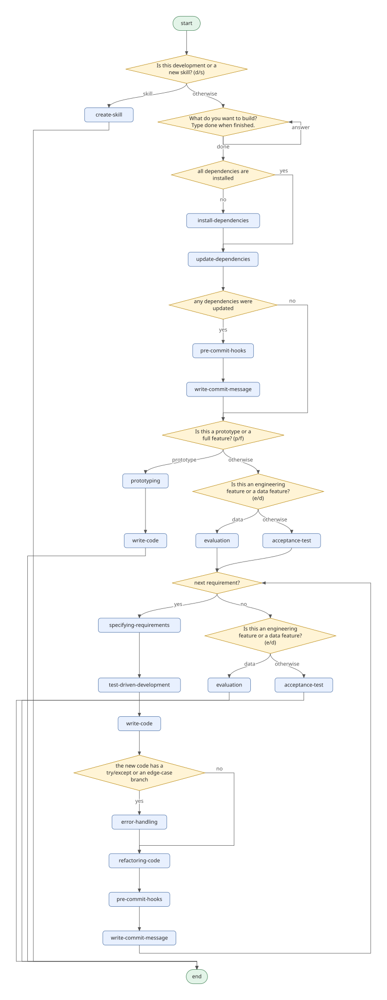

# STDD Agents

```
   _____ __________ ____     ___                     __
  / ___//_  __/ __ / __ \   /   | ____ ____  ____  / /______
  \__ \  / / / / / / / / /  / /| |/ __ `/ _ \/ __ \/ __/ ___/
 ___/ / / / / /_/ / /_/ /  / ___ / /_/ /  __/ / / / /_(__  )
/____/ /_/ /_____/_____/  /_/  |_\__, /\___/_/ /_/\__/____/
                                 /____/

          Spec-Test-Driven Development Agents
```

**Agents and configs following a Spec-Test-Driven Development process**

This repository is designed for **agent harnesses** like:
- **Claude Code**
- **Codex**
- **OpenCode**
- **Pi**


STDD Agents provides a structured workflow for developing applications using agent harnesses, emphasizing specification-first development with comprehensive testing to ensure stability while moving with higher velocity.

*Note.* The aspiration is to make this toolkit agent harness agnostic. However, it is currently heavily configured for Claude Code.

## Workflow



The diagram is generated from [`workflow.py`](skills/spec-test-driven-development/workflow.py):

```bash
uv run python -I skills/spec-test-driven-development/create_diagram.py skills/spec-test-driven-development/workflow.py workflow.svg
```

## Quick Start

### Installation

Choose your agent harness and follow the installation guide:

- **[Claude Code](docs/install/CLAUDE-CODE.md)** - Setup for Claude Code users
- **[Codex](docs/install/CODEX.md)** - Setup for Codex users
- **[OpenCode](docs/install/OPENCODE.md)** - Setup for OpenCode users
- **[Pi](docs/install/PI.md)** - Setup for Pi users
- **[Other Agents](docs/install/OTHER-AGENTS.md)** - Setup for other agent harnesses

### Install as Claude Code Plugin

```bash
/plugin marketplace add https://github.com/craigtkhill/stdd-agents
/plugin install stdd-agents@stdd-agents
```
